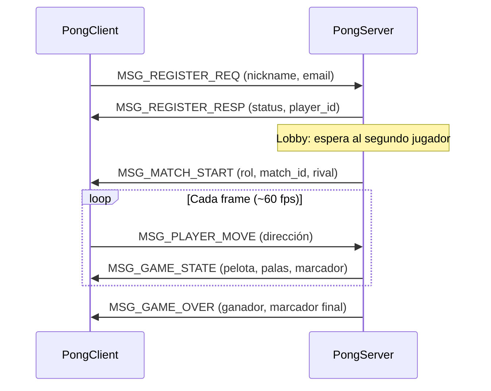

<!--
  README del Proyecto N1 - Pong (Internet: Arquitectura y Protocolos)
  [JUAN] Documento redactado y organizado por JUAN.
  [JUAN] Las secciones/notas marcadas con [JUAN] corresponden a aportes míos
         (principalmente la implementación del bucle de juego en el servidor C).
-->
# 🏓 Pong — Proyecto N1

**Asignatura:** Internet: Arquitectura y Protocolos
**Proyecto:** Pong — Juego en red bajo arquitectura Cliente/Servidor
**Protocolo de aplicación:** `MyAppGameProtocol` (binario, sobre TCP/IP)
**Lenguaje del servidor:** C (API de Sockets Berkeley)
**Lenguaje del cliente:** Python 3 / C

| Integrante | Rol |
| --- | --- |
| _(completar)_ | _(completar)_ |
| _(completar)_ | _(completar)_ |
| _(completar)_ | _(completar)_ |

---

## 1. Introducción

El propósito de este proyecto es desarrollar habilidades de programación en red,
aplicaciones concurrentes y diseño/implementación de protocolos. Para ello se
construyó una versión en red del clásico **Pong**, bajo una arquitectura
**cliente/servidor**, donde:

- El **cliente** captura la entrada del usuario y envía comandos al servidor.
- El **servidor** es la autoridad: mantiene el estado del juego, valida los
  movimientos, resuelve la física, actualiza el marcador y **difunde** el estado
  autoritativo a los clientes.

Toda la comunicación se realiza mediante la **API de Sockets Berkeley** y un
protocolo de capa de aplicación propio, codificado en **binario**.

---

## 2. Arquitectura

```
        +-----------------+          TCP (SOCK_STREAM)         +-----------------+
        |   PongClient    | <=================================> |   PongServer    |
        |  (Python 3 / C) |   MyAppGameProtocol (binario)       |       (C)       |
        +-----------------+                                     +-----------------+
              ^                                                         |
              |                                                         v
        Entrada del usuario                                    Lobby + Hilos de partida
                                                               + Logger a archivo/consola
```

- **Modelo:** servidor autoritativo. El cliente envía su *intención* de
  movimiento; el servidor calcula posiciones y difunde el estado.
- **Concurrencia:** un **hilo por partida** (`pthread`) y, dentro de cada
  partida, un **hilo lector por jugador** para recibir movimientos sin bloquear
  la simulación. [_JUAN_]
- **Transporte:** TCP (`SOCK_STREAM`). Justificación completa en
  [`docs/socket-tcp-justification.txt`](docs/socket-tcp-justification.txt).

---

## 3. Estructura del repositorio

```
pong/
├── Makefile                     # Compilación (gcc)
├── README.md                    # Este documento
├── docs/                        # Especificación del protocolo y diagramas UML
│   ├── opcode-specification.md
│   ├── socket-tcp-justification.txt
│   └── *.png                    # Máquinas de estado y diagrama de flujo
├── include/                     # Cabeceras C
│   ├── protocol.h               # Definición del protocolo binario
│   ├── server.h                 # Estructuras del servidor
│   └── logger.h                 # Interfaz del logger
└── src/
    ├── protocol.c               # Helpers de empaquetado/desempaquetado TCP
    ├── client/main.c            # Cliente de referencia (C)
    └── server/
        ├── main.c               # Punto de entrada del servidor
        ├── server.c             # Lobby, emparejamiento y bucle de juego [_JUAN_]
        └── logger.c             # Logger thread-safe
```

---

## 4. Protocolo `MyAppGameProtocol`

Protocolo **binario** de capa de aplicación. Todo mensaje inicia con un
**encabezado fijo de 3 bytes**:

| Campo | Tipo | Descripción |
| --- | --- | --- |
| `Type` | `uint8` | *Opcode* del mensaje |
| `Payload Length` | `uint16` (Network Byte Order) | Tamaño de la carga útil |

### Opcodes

| Opcode | Constante | Dirección | Payload | Descripción |
| --- | --- | --- | --- | --- |
| `0x01` | `MSG_REGISTER_REQ` | C → S | 64 B | Registro (nickname + email) |
| `0x02` | `MSG_REGISTER_RESP` | S → C | 2 B | Confirmación de registro |
| `0x03` | `MSG_MATCH_START` | S → C | 34 B | Inicio de partida y rol asignado |
| `0x04` | `MSG_PLAYER_MOVE` | C → S | 1 B | Intención de movimiento |
| `0x05` | `MSG_GAME_STATE` | S → C | 16 B | Estado autoritativo del juego |
| `0x06` | `MSG_GAME_OVER` | S → C | 3 B | Fin de partida y ganador |
| `0x07` | `MSG_DISCONNECT` | C ↔ S | 0 B | Solicitud de desconexión |

> Detalle completo de payloads en
> [`docs/opcode-specification.md`](docs/opcode-specification.md).

### Flujo de una sesión



---

## 5. Desarrollo

### 5.1 Decisiones de diseño

- **TCP en lugar de UDP:** se prioriza integridad y orden del protocolo binario.
  El volumen de datos de Pong es mínimo, por lo que el *overhead* de TCP es
  irrelevante. (Ver justificación extendida en `docs/`.)
- **Codificación binaria:** se usan estructuras *packed* (`__attribute__((packed))`)
  para garantizar que no exista relleno (padding) entre campos.
- **Servidor autoritativo:** evita inconsistencias entre clientes; el cliente
  nunca decide el estado, solo la intención.

### 5.2 Servidor concurrente

- El **lobby** (`run_server_loop`) acepta conexiones de forma secuencial,
  recibe el `MSG_REGISTER_REQ`, responde y coloca al primer jugador en espera.
  Cuando llega el segundo, crea un **hilo de partida** independiente.
- Cada partida corre en su propio `pthread`, permitiendo **múltiples parejas
  jugando simultáneamente**.

### 5.3 Bucle de juego [_JUAN_]

<!-- [JUAN] Esta subsección describe la implementación que agregué al servidor. -->

El servidor original únicamente emparejaba a los jugadores, enviaba
`MSG_MATCH_START`, hacía `sleep(3)` y cerraba la conexión: **no había lógica de
juego**. [_JUAN_]

Se implementó el bucle de simulación autoritativo dentro de `match_worker`, con
las siguientes características:

- **Tick de simulación** de ~60 fps (`nanosleep`), parámetros en constantes
  (`GAME_FIELD_W/H`, `GAME_WIN_SCORE`, etc.).
- **Un hilo lector por jugador** (`input_reader_thread`) que consume
  `MSG_PLAYER_MOVE` y guarda la última dirección, sin bloquear la simulación.
- **Física de la pelota:** rebote en paredes y en palas, con incremento de
  velocidad (`GAME_BALL_GAIN`) y ángulo de salida según el punto de impacto.
- **Puntuación y fin de partida** a los 5 puntos, con difusión de
  `MSG_GAME_STATE` cada frame y `MSG_GAME_OVER` al finalizar.
- **Registro de eventos** (puntos, golpes, inicio/fin) a través del logger.
- **Sistema de coordenadas acordado con el cliente:** campo de `1000 x 600`,
  donde `ball_x/ball_y` es el centro de la pelota y `paddle_y` es el centro
  vertical de cada pala. [_JUAN_]

> En el código, todo este bloque está delimitado por los banners
> `>>> INICIO DEL BLOQUE AGREGADO POR MÍ <<<` y
> `>>> FIN DEL BLOQUE AGREGADO POR MÍ <<<`.

### 5.4 Cliente

- **Cliente de referencia en C** (`src/client/main.c`): realiza el registro y la
  espera de emparejamiento.
- **Cliente con interfaz gráfica en Python 3**: implementa el mismo protocolo
  binario sobre `socket` (API de Berkeley) y presenta la partida con una interfaz
  tipo *neón/futurista*.

### 5.5 Logger

El servidor implementa un **logger thread-safe** (mutex) que imprime por consola
y escribe en el archivo indicado todas las peticiones entrantes, respuestas
enviadas, errores y eventos de juego.

---

## 6. Compilación y ejecución

### Compilación (gcc)

```bash
make            # genera ./server y ./client
make clean      # elimina binarios y archivos objeto
```

### Ejecución del servidor

```bash
./server <PORT> <LogFile>
# Ejemplo:
./server 8080 pong.log
```

- `PORT`: puerto de escucha (rango permitido: 1024 – 65535).
- `LogFile`: archivo donde se registra toda la actividad.

### Ejecución del cliente de referencia (C)

```bash
./client <SERVER_IP> <PORT> <NICKNAME> <EMAIL>
# Ejemplo:
./client 127.0.0.1 8080 Juan juan@mail.com
```

---

## 7. Despliegue en la nube (AWS Academy)

El servidor debe desplegarse en una instancia de **AWS Academy**:

```bash
# En la instancia (Amazon Linux / Ubuntu):
sudo yum install -y gcc make      # o: sudo apt install -y gcc make
make
./server <PORT> pong.log
# Abrir el puerto en el Security Group de la instancia
```

---

## 8. Pruebas realizadas [_JUAN_]

<!-- [JUAN] Resultados de las pruebas que ejecuté sobre el bucle de juego. -->

- **Compilación limpia:** `gcc -Wall -Wextra -pthread` sin errores ni advertencias.
- **Partida completa (2 clientes):** registro → emparejamiento → juego hasta 5-0
  → `MSG_GAME_OVER` recibido por ambos con ganador y marcador correctos.
- **Concurrencia:** 4 clientes generaron **2 partidas simultáneas** con IDs
  independientes, frames intercalados y finalización correcta de ambas.
- **Interoperabilidad:** el cliente Python y el servidor en C intercambiaron los
  mensajes byte a byte correctamente (tamaños de payload verificados: 64, 16,
  34, 2, 1 y 3 bytes).

---

## 9. Conclusiones

- Se diseñó e implementó un **protocolo binario** propio integrado sobre TCP/IP,
  demostrando la diferencia entre la capa de aplicación y el transporte.
- El modelo **servidor autoritativo** simplifica la consistencia del estado en
  juegos en red.
- El uso de **hilos** permitió atender múltiples partidas concurrentes, cumpliendo
  el requerimiento de concurrencia.
- La elección de **TCP** resultó adecuada para la naturaleza del juego y el
  tamaño reducido de sus mensajes.

---

## 10. Referencias

- Beej's Guide to C Programming — <https://beej.us/guide/bgc/>
- Beej's Guide to Network Programming — <https://beej.us/guide/bgnet/>
- GeeksforGeeks — TCP Server-Client implementation in C —
  <https://www.geeksforgeeks.org/tcp-server-client-implementation-in-c/>
- Documentación de Pong — <https://en.wikipedia.org/wiki/Pong>
