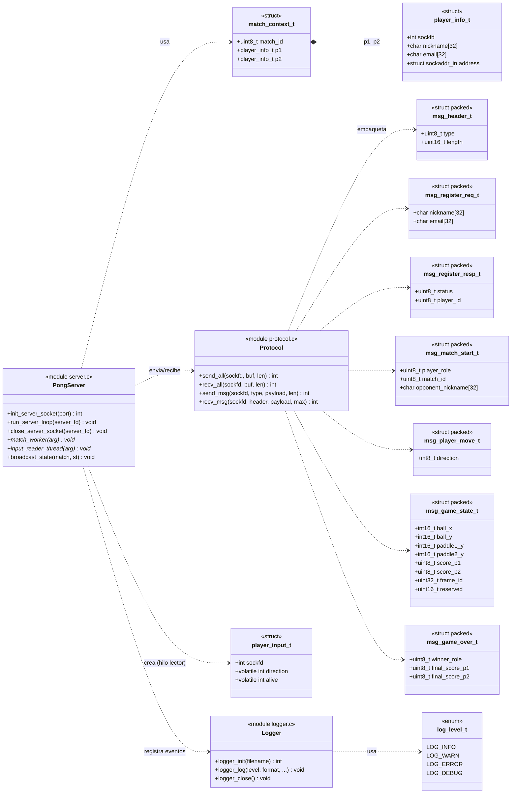

<!-- DIAGRAMA DE CLASES UML - Proyecto Pong
     [JUAN] Documento creado por JUAN a partir del codigo real:
     include/protocol.h, include/server.h, include/logger.h y src/**.c
     Se incluye en version Mermaid (GitHub lo renderiza) y en ASCII. -->

# Diagrama de Clases UML — Pong

Este documento modela **los tipos (estructuras), las funciones y sus relaciones**
tal como están implementados en C. En UML, los `struct`/`enum` de C se representan
como **clases** (con sus atributos) y las funciones como **operaciones** que
dependen del módulo donde viven.

---

## 1. Diagrama de clases (Mermaid)



---

## 2. Versión ASCII (para el tablero o el informe)

```
 ┌─────────────────────────────────────────────────────────────────────┐
 │                        CAPA DE PROTOCOLO                            │
 ├─────────────────────────────────────────────────────────────────────┤
 │  «struct packed» msg_header_t          «module» Protocol            │
 │  ─────────────────────────            ─────────────────────────     │
 │  - type   : uint8                     + send_all(sockfd,buf,len)    │
 │  - length : uint16 (Network Byte Order) + recv_all(...)              │
 │                                        + send_msg(sockfd,type,pl,len)│
 │  «struct packed» msg_game_state_t      + recv_msg(sockfd,hdr,pl,max) │
 │  - ball_x, ball_y       : int16              │                      │
 │  - paddle1_y, paddle2_y : int16              │ usa                  │
 │  - score_p1, score_p2   : uint8              ▼                      │
 │  - frame_id             : uint32      ┌──────────────┐              │
 │  - reserved             : uint16      │ msg_header_t │              │
 │                                       └──────────────┘              │
 └─────────────────────────────────────────────────────────────────────┘
                                    ▲
                                    │ envia/recibe
 ┌──────────────────────────────────┴──────────────────────────────────┐
 │                         CAPA DE SERVIDOR                            │
 ├─────────────────────────────────────────────────────────────────────┤
 │  «struct» player_info_t        «struct» match_context_t             │
 │  ───────────────────────       ────────────────────────             │
 │  - sockfd   : int              - match_id : uint8                   │
 │  - nickname : char[32]         - p1 : player_info_t   ←──┐          │
 │  - email    : char[32]         - p2 : player_info_t   ───┘ 2        │
 │  - address  : sockaddr_in                                           │
 │                                                                     │
 │  «module» PongServer                                                │
 │  ──────────────────────────────────────────────────────────         │
 │  + init_server_socket(port) : int                                   │
 │  + run_server_loop(server_fd) : void     (lobby + emparejamiento)   │
 │  + close_server_socket(server_fd) : void                            │
 │  + match_worker(arg) : void*             (bucle de juego)           │
 │  + input_reader_thread(arg) : void*      (recibe MSG_PLAYER_MOVE)   │
 │  + broadcast_state(match, st) : void                                │
 └──────────────────────────────────┬──────────────────────────────────┘
                                    │ registra eventos
 ┌──────────────────────────────────┴──────────────────────────────────┐
 │                          CAPA DE LOGGER                             │
 ├─────────────────────────────────────────────────────────────────────┤
 │  «enum» log_level_t      «module» Logger                            │
 │  ────────────────        ────────────────────────────               │
 │  LOG_INFO                + logger_init(filename) : int              │
 │  LOG_WARN                + logger_log(level, fmt, ...) : void       │
 │  LOG_ERROR               + logger_close() : void                    │
 │  LOG_DEBUG                                                          │
 └─────────────────────────────────────────────────────────────────────┘
```

---

## 3. Relaciones (lectura rápida)

| Relación | Tipo UML | Significado |
| --- | --- | --- |
| `match_context_t` → `player_info_t` | **Composición** (`2`) | Una partida contiene exactamente 2 jugadores |
| `PongServer` → `match_context_t` | **Dependencia** | El servidor usa el contexto de partida |
| `PongServer` → `player_input_t` | **Dependencia** | Cada partida crea un hilo lector por jugador |
| `Protocol` → `msg_*_t` | **Dependencia** | Empaqueta/desempaqueta los mensajes del protocolo |
| `PongServer` → `Protocol` | **Dependencia** | Envía y recibe por los helpers del protocolo |
| `PongServer` → `Logger` | **Dependencia** | Registra todos los eventos |
| `Logger` → `log_level_t` | **Dependencia** | Usa los niveles de log |

---

## 4. Nota sobre C vs. UML

En C no existen clases; el proyecto es **procedural**. Por eso el diagrama aplica la
convención de mapear:

* `struct` / `enum` → **clase** (atributos = campos)
* Cada archivo `.c` → **módulo** con sus **operaciones** (las funciones)
* `static` → miembro **privado**; funciones públicas del `.h` → **públicas**

Esto es el estándar aceptado para documentar software en C con notación UML.
